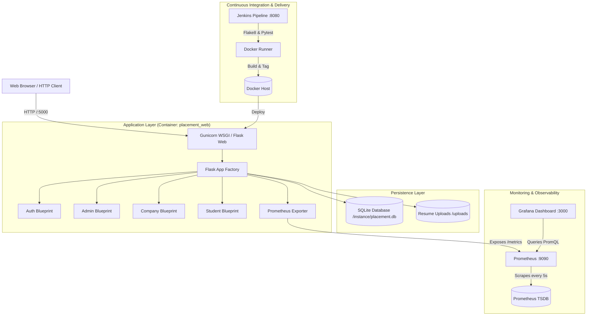

# Campus Placement Management System (PMS)

[](https://www.python.org/)
[](https://flask.palletsprojects.com/)
[-brightgreen.svg)]()
[](https://www.docker.com/)
[](https://prometheus.io/)
[](https://grafana.com/)

A modern, production-ready, full-stack **Campus Placement Management System** built with Python Flask, Flask-SQLAlchemy, Flask-Login, and Bootstrap 5. The platform streamlines college campus hiring by connecting students, corporate hiring partners, and college placement coordinators into an automated, observable pipeline.

---

## 1. System Architecture



---

## 2. Technology Stack & Role Matrix

### Core Technologies
- **Backend**: Python 3.11+, Flask 3.0, Flask-SQLAlchemy (SQLite ORM), Flask-Login, Flask-WTF, Werkzeug password hashing.
- **Frontend**: Bootstrap 5, Bootstrap Icons, responsive Jinja2 templating, custom modern UI stylesheet.
- **Observability**: `prometheus-flask-exporter`, custom business Prometheus gauges/counters, Prometheus `v2.52.0`, Grafana `11.0.0`.
- **Containerization**: Docker multi-stage image with non-root security user, Docker Compose.
- **CI/CD**: Jenkins LTS with declarative pipeline (`Jenkinsfile`), Docker CLI, and automated smoke testing.

### Role Permission Matrix

| Feature / Endpoint | Admin (TPO) | Recruiter (Company) | Student | Guest |
| :--- | :---: | :---: | :---: | :---: |
| Browse Public Landing & Opportunities | :white_check_mark: | :white_check_mark: | :white_check_mark: | :white_check_mark: |
| Register Account | :x: (Pre-seeded) | :white_check_mark: (Pending) | :white_check_mark: | :white_check_mark: |
| System Health (`/health`) & Telemetry (`/metrics`) | :white_check_mark: | :white_check_mark: | :white_check_mark: | :white_check_mark: |
| Administrative KPI Dashboard | :white_check_mark: | :x: (403) | :x: (403) | :x: (302) |
| Approve / Reject Company Registrations | :white_check_mark: | :x: (403) | :x: (403) | :x: (302) |
| Activate / Deactivate Student & Company Accounts | :white_check_mark: | :x: (403) | :x: (403) | :x: (302) |
| Post, Edit, Toggle, and Delete Jobs | :x: | :white_check_mark: (If Approved) | :x: (403) | :x: (302) |
| Review Applicants & Download Resumes | :x: | :white_check_mark: (Own Jobs) | :x: (403) | :x: (302) |
| Shortlist / Select Candidates with Feedback | :x: | :white_check_mark: (Own Jobs) | :x: (403) | :x: (302) |
| Upload PDF Resume & Update Academic Profile | :x: | :x: (403) | :white_check_mark: | :x: (302) |
| Filter Eligible Jobs & Apply with Eligibility Check | :x: | :x: (403) | :white_check_mark: | :x: (302) |
| Track Application Status & Interview Feedback | :x: | :x: (403) | :white_check_mark: | :x: (302) |

---

## 3. Seeded Accounts & Credentials

The database can be initialized with sample companies, students, jobs, and applications using `python seed.py`:

| Role | Email Address | Password | Account Details |
| :--- | :--- | :--- | :--- |
| **Admin (TPO)** | `admin@placement.com` | `Admin@123` | Master Placement Officer |
| **Company 1** | `recruiting@google.com` | `Company@123` | Google Cloud India (Approved) |
| **Company 2** | `campus@amazon.in` | `Company@123` | Amazon Development Centre (Approved) |
| **Company 3** | `talent@startup.ai` | `Company@123` | AI Frontier Labs (**Pending Approval**) |
| **Student 1** | `aarav.sharma@campus.edu` | `Student@123` | CSE, CGPA 9.2, Has PDF resume |
| **Student 2** | `sneha.patel@campus.edu` | `Student@123` | IT, CGPA 8.7, Has PDF resume |
| **Student 3** | `rohan.gupta@campus.edu` | `Student@123` | ECE, CGPA 7.4 |
| **Student 4** | `ananya.verma@campus.edu` | `Student@123` | CSE, CGPA 8.9 |

---

## 4. Quickstart Guide

### Option A: Running with Docker Compose (Recommended)

1. **Clone and navigate to repository**:
   ```bash
   cd placement-management-system
   ```

2. **Launch all services** (Flask web app, Prometheus, Grafana):
   ```bash
   docker compose up -d --build
   ```

3. **Seed sample data** into the running container:
   ```bash
   docker compose exec web python seed.py
   ```

4. **Access services**:
   - **Web Application**: [http://localhost:5000](http://localhost:5000)
   - **Healthcheck**: [http://localhost:5000/health](http://localhost:5000/health)
   - **Prometheus Telemetry**: [http://localhost:5000/metrics](http://localhost:5000/metrics)
   - **Prometheus Server**: [http://localhost:9090](http://localhost:9090)
   - **Grafana Dashboards**: [http://localhost:3000](http://localhost:3000) (User: `admin` / Password: `admin`)

---

### Option B: Running Locally with Python Virtualenv

1. **Create and activate virtual environment**:
   ```bash
   python -m venv venv
   # On Windows:
   .\venv\Scripts\activate
   # On Linux/macOS:
   source venv/bin/activate
   ```

2. **Install pinned dependencies**:
   ```bash
   pip install -r requirements.txt
   ```

3. **Initialize and seed database**:
   ```bash
   python seed.py
   ```

4. **Run development server**:
   ```bash
   python run.py
   ```
   Open [http://localhost:5000](http://localhost:5000) in your browser.

---

## 5. Running Tests & Linting

### Pytest Test Suite
The project contains 22 automated unit and integration tests covering authentication, role-based security, eligibility enforcement, job application flow, duplicate prevention, and health checks:

```bash
pytest -v --cov=app tests/
```

*Results: 22 passed, 84% statement coverage.*

### Code Style & Linting
Enforce flake8 standards (`max-line-length = 140`):

```bash
flake8 app tests config.py run.py seed.py
```

---

## 6. Prometheus Metrics Catalog

The application exposes Prometheus metrics at `/metrics` combining standard HTTP server telemetry with domain-specific placement business metrics:

| Metric Identifier | Type | Description |
| :--- | :--- | :--- |
| `flask_http_request_total` | Counter | Total HTTP requests handled by the Flask application, partitioned by status code and method. |
| `flask_http_request_duration_seconds` | Histogram | Request latency distributions with bucket intervals for computing avg and p95 latencies. |
| `placement_registered_students_total` | Gauge | Total number of registered student candidates in the database. |
| `placement_active_jobs_total` | Gauge | Total number of currently active campus job openings. |
| `placement_applications_total` | Gauge | Number of applications grouped by status: `applied`, `shortlisted`, `selected`, `rejected`. |
| `placement_logins_total` | Counter | Cumulative login attempts grouped by outcome: `status="success"` or `status="failure"`. |
| `up` | Gauge | Scrape target health status (`1` = reachable, `0` = unreachable). |

---

## 7. Grafana Dashboards & Monitoring

Grafana is pre-configured to automatically provision the Prometheus datasource and the **Placement Management System** dashboard upon startup.

- **URL**: [http://localhost:3000](http://localhost:3000)
- **Default Credentials**: `admin` / `admin`
- **Dashboard Title**: `Placement Management System - Operational & Business Analytics`
- **Auto-Refresh**: Configured to 5 seconds.

### Included Panels (10 Visualizations):
1. **Application Up / Down Status**: Stat panel reflecting real-time container health.
2. **Registered Students**: Live count of enrolled candidates.
3. **Active Job Postings**: Live count of open recruiting drives.
4. **HTTP 5xx Error Rate (%)**: Real-time error percentage with warning/critical thresholds.
5. **Requests per Second (Throughput)**: Smooth time-series curve measuring traffic velocity.
6. **HTTP Status Code Breakdown**: Stacked bar timeseries comparing 2xx, 3xx, 4xx, and 5xx responses.
7. **Average Response Latency**: Time-series tracking server latency trends in milliseconds/seconds.
8. **95th Percentile Latency (p95)**: Histogram quantile tracking upper latency bounds.
9. **Applications by Status**: Interactive pie chart displaying pipeline distribution.
10. **Login Success vs Failure**: Pie chart visualizing authentication security trends.

### Simulating Real-Time Dashboard Traffic
To generate continuous, realistic activity for live demos:
```bash
python scripts/traffic_generator.py --url http://localhost:5000 --delay 0.5
```

---

## 8. Jenkins CI/CD Pipeline

The repository includes a production-grade Jenkins declarative pipeline (`Jenkinsfile`) and dedicated runner (`docker-compose.jenkins.yml`).

### Running Jenkins:
```bash
docker compose -f docker-compose.jenkins.yml up -d --build
```
Access Jenkins at [http://localhost:8080](http://localhost:8080).

### Pipeline Stages:
1. **Checkout**: Pulls code from SCM repository (`triggers { githubPush(); pollSCM('H/2 * * * *') }`).
2. **Setup Virtualenv & Install Dependencies**: Creates isolated virtual environment and installs `requirements.txt`.
3. **Build & Lint**: Validates code formatting and PEP8 standards (`flake8`).
4. **Automated Tests (Quality Gate)**: Executes all tests (`pytest`). *Strict Rule: If tests fail, pipeline stops immediately and halts deployment.*
5. **Docker Build**: Builds production container tagged with both `v${BUILD_NUMBER}` and `latest`.
6. **Docker Hub Push**: Authenticates using Jenkins credentials ID `dockerhub-creds` and pushes `v${BUILD_NUMBER}` and `latest` tags to Docker Hub.
7. **Deploy Services**: Orchestrates container rollout using `docker compose up -d --build`.
8. **Smoke Test**: Queries `/health` (verifying `{"status": "ok"}`) and `/metrics` (verifying custom metrics). Fails build if endpoints fail.
9. **Post-execution**: Cleans workspace (`cleanWs()`) and emits pipeline success/failure notification.

---

## 9. Prometheus Alerting Rules & Demonstration

Alert rules are defined in `prometheus/alert.rules.yml` and loaded automatically by Prometheus:

| Alert Name | Condition | Severity | Description |
| :--- | :--- | :--- | :--- |
| **ApplicationDown** | `up{job="placement_app"} == 0` for 1m (or 30s) | Critical | Triggered when the web application container stops or crashes. |
| **HighCpuUsage** | `CPU > 80%` for 5m (or 30s) | Warning | Host CPU utilization exceeds 80%. |
| **HighHttp5xxErrors** | `rate(5xx) > 0` for 30s | Critical | Application is emitting server error responses. |
| **HighLatency** | `p95 latency > 2.0s` for 1m | Warning | 95th percentile response latency exceeds 2 seconds. |

### How to Trigger Alerts During Live Demo:
1. **Trigger Application Down Alert**:
   ```bash
   docker stop placement_web
   ```
   Open `http://localhost:9090/alerts` and watch `ApplicationDown` transition to **FIRING (Red)**! Restart with `docker start placement_web`.
2. **Trigger High CPU Alert**:
   ```bash
   docker run --rm -it progrium/stress --cpu 4 --timeout 45s
   ```
   Observe the CPU gauge on Grafana spike and the `HighCpuUsage` alert fire in Prometheus.

---

## 10. Supporting Documentation & Guides
- **12-Step Live Demo Script**: [docs/demo-script.md](file:///C:/Users/Rudra/.gemini/antigravity-ide/scratch/placement-management-system/docs/demo-script.md)
- **Viva & Screenshots Checklist**: [docs/screenshots-checklist.md](file:///C:/Users/Rudra/.gemini/antigravity-ide/scratch/placement-management-system/docs/screenshots-checklist.md)
- **Postman API Test Collection**: [docs/postman_collection.json](file:///C:/Users/Rudra/.gemini/antigravity-ide/scratch/placement-management-system/docs/postman_collection.json)


---

## 9. Assumptions Made

As requested, the following design decisions and assumptions were implemented:

1. **Database Selection**: SQLite is used as specified. In production container mode, the database file is placed in `/app/instance/placement.db` with a Docker named volume (`placement_instance`) to persist data across container restarts.
2. **Gunicorn Concurrency & Prometheus Multiprocessing**:
   - Gunicorn is configured with `--workers 1 --threads 4`. This delivers high concurrent request throughput, guarantees zero SQLite write-lock contention, and avoids multi-process metric directory synchronization issues.
   - For multi-worker deployments, `PROMETHEUS_MULTIPROC_DIR` is pre-configured and exported in the Dockerfile.
3. **Company Approval Workflow**: New company registrations are set to `pending` by default. Recruiters cannot create job postings until approved by an administrator.
4. **Candidate Eligibility Logic**: Eligibility is strictly enforced: `student.cgpa >= job.min_cgpa` and `now <= job.deadline`. If ineligible, application submission is blocked with descriptive feedback.
5. **Single Active Placement Policy**: When a company selects an applicant (`selected`), the student's status is automatically marked as `placed`, visually updating their candidate card and admin dashboards.
6. **Resume File Security**: Resume uploads are strictly restricted to PDF format (`.pdf`), validated on both client and server, sanitized using `secure_filename`, capped at 5MB, and stored in a persistent directory.

---

## 10. Troubleshooting & Common Issues

| Issue | Cause | Solution |
| :--- | :--- | :--- |
| **Database file locked (`sqlite3.OperationalError: database is locked`)** | Concurrent write operations from multiple processes | Use threaded single-worker Gunicorn or verify that no dangling processes have opened `instance/placement.db`. |
| **Grafana shows "No Data"** | Prometheus hasn't completed its first scrape cycle (5s) or traffic hasn't occurred | Run `python scripts/traffic_generator.py` to seed HTTP traffic. |
| **Port 5000 or 8080 already in use** | Local process or prior container bound to port | Check active ports with `netstat -ano` or adjust host port mappings in `docker-compose.yml`. |
| **Jenkins Docker permission denied** | Jenkins container cannot access mounted `/var/run/docker.sock` | Ensure `user: root` is present in `docker-compose.jenkins.yml`. |
| **Resume upload fails** | File is not a `.pdf` or exceeds 5MB | Ensure the file ends with `.pdf` and is under 5MB in size. |

---

## 11. Complete Route Inventory

| Route | HTTP Methods | Blueprint | Access Level | Description |
| :--- | :---: | :---: | :---: | :--- |
| `/` | GET | Auth | Public | Landing page with placement statistics and features |
| `/health` | GET | Root | Public | Container health check returning `{"status": "ok"}` |
| `/metrics` | GET | Metrics | Public | Prometheus monitoring scrape endpoint |
| `/auth/login` | GET, POST | Auth | Public | Unified login for Admin, Student, and Company |
| `/auth/register/student` | GET, POST | Auth | Public | Student self-registration portal |
| `/auth/register/company` | GET, POST | Auth | Public | Recruiter corporate registration portal |
| `/auth/logout` | GET | Auth | Authenticated | Terminates active user session |
| `/admin/dashboard` | GET | Admin | Admin Only | Administrative overview and placement metrics |
| `/admin/companies` | GET | Admin | Admin Only | Company approval, rejection, and account management |
| `/admin/companies/<id>/approve` | POST | Admin | Admin Only | Approve pending company |
| `/admin/companies/<id>/reject` | POST | Admin | Admin Only | Reject pending company |
| `/admin/companies/<id>/toggle-status` | POST | Admin | Admin Only | Activate / deactivate company |
| `/admin/students` | GET | Admin | Admin Only | Student candidate registry with branch & status filters |
| `/admin/students/<id>/toggle-status` | POST | Admin | Admin Only | Activate / deactivate student |
| `/admin/jobs` | GET | Admin | Admin Only | Global job postings audit |
| `/admin/applications` | GET | Admin | Admin Only | Campus applications audit log |
| `/company/dashboard` | GET | Company | Company Only | Recruiter dashboard and jobs overview |
| `/company/jobs/new` | GET, POST | Company | Company Only | Create new campus job posting |
| `/company/jobs/<id>/edit` | GET, POST | Company | Company Only | Edit existing job requirements |
| `/company/jobs/<id>/toggle` | POST | Company | Company Only | Toggle job active/paused status |
| `/company/jobs/<id>/delete` | POST | Company | Company Only | Delete job posting and associated records |
| `/company/jobs/<id>/applicants` | GET | Company | Company Only | Review applicants for a specific opening |
| `/company/applications/<id>/status` | POST | Company | Company Only | Update applicant status (shortlist/select/reject) |
| `/student/dashboard` | GET | Student | Student Only | Student portal overview and recommended jobs |
| `/student/profile` | GET, POST | Student | Student Only | Manage academic details and PDF resume |
| `/student/jobs` | GET | Student | Student Only | Explore open jobs with search & eligibility filter |
| `/student/jobs/<id>` | GET | Student | Student Only | Detailed job specifications & application submission |
| `/student/jobs/<id>/apply` | POST | Student | Student Only | Submit application with eligibility validation |
| `/student/applications` | GET | Student | Student Only | Track application pipeline and recruiter remarks |
| `/student/resumes/<filename>` | GET | Student | Authenticated | Secure resume download endpoint |
