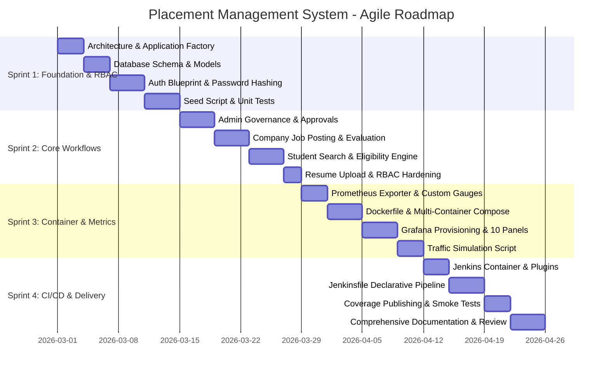

# Agile Project Management Documentation
## Placement Management System (PMS)

---

## 1. Product Vision & Personas

### Product Vision
To provide modern educational institutions with a high-reliability, end-to-end digital campus placement management platform. The system bridges students, corporate hiring partners, and college training & placement officers (TPOs) into a single unified workflow, replacing fragmented spreadsheets and manual verification with role-based access, automated eligibility validation, real-time status tracking, and DevOps observability.

### Target Personas

| Persona | Role | Primary Goals | Key Pain Points |
| :--- | :--- | :--- | :--- |
| **Dr. Rajesh Varma** | Training & Placement Officer (TPO / Admin) | Centralize drive coordination, approve verified recruiters, audit student eligibility, and monitor campus placement rates. | Manual verification of resumes and CGPA; inconsistent tracking across spreadsheets. |
| **Aarav Sharma** | Final-Year B.Tech Student | Discover matching company openings, verify personal eligibility against CGPA cutoffs, submit applications seamlessly, and track interview progress. | Missed application deadlines; lack of feedback on submitted applications. |
| **Priya Sundaram** | Corporate Technical Recruiter (Google / Amazon) | Post job requirements with explicit cutoffs, review verified candidate profiles and PDF resumes, and progress candidates through review stages. | Sifting through unqualified applicants; delayed candidate communication. |

---

## 2. Epics, User Stories & Acceptance Criteria

### Epic 1: Authentication & Role-Based Access Control (RBAC)

#### US-1.1: Multi-Role Account Creation & Authentication
- **As a** student or company recruiter
- **I want to** register for an account with my specific profile details and log in securely
- **So that** I can access my dedicated portal without unauthorized access to other roles.
- **Priority:** High | **Story Points:** 5
- **Acceptance Criteria:**
  - Passwords hashed using Werkzeug PBKDF2/scrypt before persistence.
  - Student registration requires Full Name, College Roll Number, Branch, and CGPA.
  - Company registration defaults to `pending` approval status.
  - Role-based redirection after login: Admin &rarr; `/admin/dashboard`, Company &rarr; `/company/dashboard`, Student &rarr; `/student/dashboard`.
  - Inactive/deactivated accounts are prevented from logging in with a clear message.

#### US-1.2: Administrative Role Enforcement
- **As an** administrator
- **I want to** restrict access to sensitive routes such that only authorized roles can invoke them
- **So that** cross-role escalation is prevented.
- **Priority:** High | **Story Points:** 3
- **Acceptance Criteria:**
  - Any access to `/admin/*` by non-admins returns HTTP 403 Forbidden.
  - Unauthenticated requests redirect to `/auth/login` with next-destination preservation.

---

### Epic 2: Administrative Governance & Approvals

#### US-2.1: Recruiter Verification & Onboarding
- **As a** Placement Officer (Admin)
- **I want to** review and approve or reject new company registration requests
- **So that** only legitimate organizations can post jobs and access student contact details.
- **Priority:** High | **Story Points:** 5
- **Acceptance Criteria:**
  - Dedicated admin view listing pending, approved, and rejected companies.
  - One-click approve and reject actions with database state persistence.
  - Unapproved companies are prevented from posting jobs.

#### US-2.2: Placement Statistics & Student Auditing
- **As an** administrator
- **I want to** view real-time placement statistics (total students, companies, jobs, applications, placed ratio)
- **So that** I can assess campus drive performance at a glance.
- **Priority:** Medium | **Story Points:** 5
- **Acceptance Criteria:**
  - Admin dashboard displays active counts and percentage of placed students.
  - Student list filterable by branch and placement status (placed/unplaced).
  - Ability to deactivate or reactivate student and company accounts.

---

### Epic 3: Recruiter Job Drives & Applicant Evaluation

#### US-3.1: Job Drive Creation & Lifecycle Management
- **As an** approved corporate recruiter
- **I want to** create, update, and manage job postings with CGPA cutoffs, deadlines, and skill requirements
- **So that** students understand the expectations and timeline for each drive.
- **Priority:** High | **Story Points:** 5
- **Acceptance Criteria:**
  - Form validation for job title, CTC package (LPA), minimum CGPA, and deadline date.
  - Option to toggle job status active/paused.
  - Company can only view, edit, or delete its own job postings.

#### US-3.2: Candidate Evaluation & Selection
- **As a** recruiter
- **I want to** review applicants for each job, download their PDF resumes, and update application status
- **So that** qualified candidates progress toward offers.
- **Priority:** High | **Story Points:** 5
- **Acceptance Criteria:**
  - Candidate table displaying Name, Branch, CGPA, Skills, and Resume PDF link.
  - Modal or form to update status (`applied`, `shortlisted`, `selected`, `rejected`) and leave feedback remarks.
  - When status is updated to `selected`, the student's global `placement_status` automatically transitions to `placed`.

---

### Epic 4: Student Discovery & One-Click Application

#### US-4.1: Profile & PDF Resume Management
- **As a** student
- **I want to** maintain my academic profile and upload my PDF resume (up to 5MB)
- **So that** recruiters receive my latest qualifications during application review.
- **Priority:** High | **Story Points:** 3
- **Acceptance Criteria:**
  - Secure filename sanitization via `werkzeug.utils.secure_filename`.
  - Server-side validation enforcing `.pdf` format and file size limits.
  - Download endpoint verifying authentication.

#### US-4.2: Job Discovery & Eligibility Verification
- **As a** student
- **I want to** browse active jobs, filter for "Eligible Only", and apply in one click
- **So that** I focus on opportunities where I meet all criteria.
- **Priority:** High | **Story Points:** 5
- **Acceptance Criteria:**
  - Real-time eligibility badge displayed on each job card based on `student.cgpa >= job.min_cgpa`.
  - Filter toggle to display only eligible and unexpired jobs.
  - Application submission blocked if student's CGPA is below cutoff or deadline has passed.
  - Duplicate applications for the same job are strictly blocked with an error message.

---

### Epic 5: DevOps, Containerization & Observability

#### US-5.1: Containerized Production Deployment
- **As a** DevOps engineer
- **I want to** containerize the Flask application with Gunicorn, non-root user, and Docker Compose
- **So that** the system can be deployed identically across development, staging, and production.
- **Priority:** High | **Story Points:** 5
- **Acceptance Criteria:**
  - Multi-service `docker-compose.yml` orchestrating `web`, `prometheus`, and `grafana`.
  - Named volumes for database persistence and resume uploads.
  - Healthcheck on `/health` returning HTTP 200 with JSON status.

#### US-5.2: Application Performance & Business Telemetry
- **As a** systems administrator
- **I want to** monitor HTTP latency, request rates, error codes, and business metrics via Grafana
- **So that** system bottlenecks, traffic spikes, and placement KPIs are visible in real time.
- **Priority:** High | **Story Points:** 5
- **Acceptance Criteria:**
  - Prometheus scraping `/metrics` every 5 seconds.
  - Custom metrics exported: student counts, active jobs, applications by status, login outcomes.
  - Pre-provisioned Grafana dashboard with 10 panels and 5s auto-refresh.

#### US-5.3: Automated CI/CD Pipeline
- **As a** lead developer
- **I want to** execute a continuous integration and deployment pipeline on every code change
- **So that** regressions are caught before container images are deployed.
- **Priority:** High | **Story Points:** 5
- **Acceptance Criteria:**
  - Jenkins declarative pipeline running Flake8 linting, Pytest test suite with code coverage.
  - Automated Docker image build and deployment via Docker Compose.
  - Automated smoke test verifying `/health` and `/metrics` before marking build successful.

---

## 3. Sprint Breakdown

### Sprint 1: Core Architecture, RBAC & Models
- **Focus:** Setup project directory, Flask application factory, SQLAlchemy ORM models, authentication blueprint, password hashing, and baseline unit tests.
- **Deliverables:** Working Auth system, SQLite schema, database seeder, test fixtures.

### Sprint 2: Workflows, Eligibility & Portals
- **Focus:** Admin dashboard, company approval flow, recruiter job management, student application engine, CGPA cutoff rules, and resume uploading.
- **Deliverables:** All 4 role portals operational, 22 passing unit tests covering all workflows.

### Sprint 3: Containerization & Observability
- **Focus:** Multi-stage Dockerfile with non-root security, Docker Compose service topology, Prometheus custom metrics exporter, and Grafana dashboard auto-provisioning.
- **Deliverables:** `web`, `prometheus`, and `grafana` up on `placement-net` with live data flow.

### Sprint 4: CI/CD Pipeline & Delivery
- **Focus:** Jenkins LTS container with Docker CLI, declarative `Jenkinsfile` with 7 stages, automated smoke testing, traffic generation, and documentation.
- **Deliverables:** Reproducible CI/CD pipeline, traffic simulator, complete operational README.

---

## 4. Definition of Done (DoD) Checklist

For any user story or sprint deliverable to be marked as "Done", the following criteria must be satisfied:

- [x] **Functionality:** Meets all defined acceptance criteria with positive and negative path validation.
- [x] **Code Quality:** Passes `flake8` lint checks with zero errors (`max-line-length = 140`).
- [x] **Automated Testing:** Pytest unit test coverage exceeds 80% (achieved 84% across 22 tests).
- [x] **Security:** Passwords hashed with cryptographic salts; CSRF protection active; RBAC enforced on every route; no credentials checked into git.
- [x] **Containerization:** Builds cleanly via Docker without root privilege escalation; healthcheck configured.
- [x] **Observability:** Custom business metrics and HTTP telemetry exposed via `/metrics` and visualized on Grafana.
- [x] **Documentation:** Code documented with docstrings; configuration documented in README and architecture diagrams.

---

## 5. Release Plan & Future Roadmap

| Milestone | Target Scope | Status |
| :--- | :--- | :--- |
| **v1.0.0 (Current)** | Complete Flask web app, 3 roles, SQLite ORM, Prometheus metrics, Grafana dashboard, Docker Compose, Jenkins CI/CD. | **Delivered** |
| **v1.1.0** | Email & SMS Notifications: Automated alerts on application status update (shortlisted, interview date, offer). | Planned |
| **v1.2.0** | AI Resume Parsing: Automatic extraction of skills, education, and projects using open NLP models. | Planned |
| **v2.0.0** | Multi-College Tenancy & PostgreSQL: Migration from SQLite to distributed PostgreSQL with multi-tenant college isolation. | Planned |
